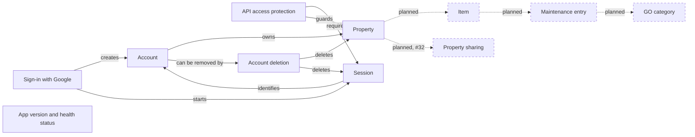

# Knowledge Base Index

Start here, every time, before you plan, build or review. Read this page in full, then every article that is relevant to your task. Maintained by agents with every change, per `.agents/skills/wiki/SKILL.md` ([how project knowledge is managed](process/project-knowledge.md)).

## Concept map

Verified against the code on 2026-11-19. Solid boxes exist in the code; dashed boxes are planned and have no code yet.

| Concept | Article | Code entry point | Related to |
|---------|---------|------------------|------------|
| Property | [Property](product/property.md) | `api/src/properties.ts`, `api/src/propertyRepository.ts`, `api/migrations/002_properties.sql`, `api/migrations/004_property_accounts.sql`, `web/src/components/PropertyForm.tsx` | Account, API access protection, Account deletion |
| Account | [Account](product/account.md) | `api/src/auth.ts`, `api/src/authStores.ts`, `api/migrations/003_users_sessions.sql`, `web/src/components/AccountView.tsx` | Property, Session, Sign-in with Google, Account deletion |
| Session | [Authentication](architecture/authentication.md) | `api/src/auth.ts`, `api/src/authStores.ts`, `api/src/authRoutes.ts`, `web/src/AuthGate.tsx` | Account, Sign-in with Google, API access protection |
| Sign-in with Google (including the labelled test sign-in) | [Authentication](architecture/authentication.md) | `api/src/authRoutes.ts`, `api/src/googleClient.ts`, `api/src/auth.ts` (`loadAuthConfig`), `web/src/components/LoginScreen.tsx` | Account, Session |
| Account deletion | [Account deletion](product/account-deletion.md) | `api/src/authRoutes.ts`, `api/src/authStores.ts`, `web/src/components/DeleteAccountDialog.tsx` | Account, Property, Session |
| API access protection | [Authentication](architecture/authentication.md) | `api/src/authRoutes.ts` (`requireUser`), `api/src/app.ts` | Session, Property |
| App version and health status | [App version and health status](product/app-version.md) | `api/src/app.ts`, `api/src/server.ts`, `web/src/api.ts`, `web/src/App.tsx` | none |
| Item (planned) | [Home Maintenance Log](product/home-maintenance-log.md) | none (planned) | Property, Maintenance entry |
| Maintenance entry (planned) | [Home Maintenance Log](product/home-maintenance-log.md) | none (planned) | Item, GO category |
| GO category (planned) | [GO Value Categories](product/go-categories.md) | none (planned) | Maintenance entry |
| Property sharing (planned, #32) | none yet | none (planned) | Property, Account |

## Articles by topic

## product

What the app is, its scope and requirements.

| Article | Summary | Updated |
|---------|---------|---------|
| [Home Maintenance Log](product/home-maintenance-log.md) | Product overview and scope v1: data model (Property exists; Item and Maintenance entry planned), requirements, out of scope, links to the concept articles (SYNTHETIC) | 2026-11-19 |
| [Property](product/property.md) | Property concept: identity is address plus owner, required and optional fields, validation limits, one account per property, 404 for other accounts, hard delete, selection per browser, unowned properties never claimed (decisions 001 to 005, 011 to 014) | 2026-11-19 |
| [Account](product/account.md) | Account concept: created on first Google sign-in, matched on Google user id, stored fields, email and name stored as exception to synthetic data (decisions 006, 007, 010) | 2026-11-19 |
| [Account deletion](product/account-deletion.md) | Account view, danger zone, typed DELETE, what is deleted in one transaction, no grace period, logging (decisions 015, 016) | 2026-11-19 |
| [App version and health status](product/app-version.md) | `/api/version`, footer text, `/api/health` answers, API status badge, use in the deploy smoke check (decision 019) | 2026-11-19 |
| [GO Value Categories](product/go-categories.md) | GO Safer / Cheaper / Better and how the pilot uses them; open question on boiler service | 2026-11-19 |

## architecture

How the software is built: system, data model, API, auth, deploy.

| Article | Summary | Updated |
|---------|---------|---------|
| [System overview](architecture/system-overview.md) | Web (React, nginx), API (Hono), PostgreSQL 17, compose services and environment variables by name, local stack, CI, deploy script, preview and production environments, Caddy edge proxy (decisions 009, 017) | 2026-11-19 |
| [Data model](architecture/data-model.md) | Tables app_info, properties, users, sessions, schema_migrations: keys, constraints, unique indexes, cascading and non-cascading foreign keys, migrations 001 to 004, the migration runner, stale comment in 004 (decisions 012, 014, 016, 018) | 2026-11-19 |
| [API](architecture/api.md) | Routes with method, public or protected, status codes, error bodies, dependency injection, logging (decisions 011, 017) | 2026-11-19 |
| [Authentication](architecture/authentication.md) | Concepts Sign-in with Google (code flow, PKCE, state, nonce), test sign-in, fail-closed start-up, Session (hashed cookie token, 30 days sliding), API access protection (decisions 006 to 010) | 2026-11-19 |

## design

Design concepts, UI patterns, screens; assets in `design/assets/`.

| Article | Summary | Updated |
|---------|---------|---------|
| [Screens](design/screens.md) | Login, empty state, switcher, details, add and edit form, delete dialogs, Account view, header and footer; behaviour at 390 px as far as the code shows it | 2026-11-19 |
| [UI patterns](design/ui-patterns.md) | Button classes, form fields, inline errors, native modal dialogs, status and alert regions, danger zone, layout widths | 2026-11-19 |

## decisions

One record per product or technical decision.

| Record | Summary | Updated |
|--------|---------|---------|
| [001](decisions/001-property-identity-address-and-owner.md) | Property identity is normalised address plus owner name (Property) | 2026-11-19 |
| [002](decisions/002-properties-are-hard-deleted.md) | Properties are deleted permanently after confirmation (Property) | 2026-11-19 |
| [003](decisions/003-property-editing-is-included.md) | Editing is part of the first version, at the product owner's request (Property) | 2026-11-19 |
| [004](decisions/004-selected-property-remembered-per-browser.md) | Selected property is remembered per browser and cleared on sign-out (Property) | 2026-11-19 |
| [005](decisions/005-countries-nl-and-de.md) | Countries NL and DE, NL default (Property) | 2026-11-19 |
| [006](decisions/006-google-only-sign-in-with-open-sign-up.md) | Google is the only sign-in, open sign-up, scopes openid email profile (Account) | 2026-11-19 |
| [007](decisions/007-accounts-matched-on-google-user-id.md) | Accounts are matched on the Google user id, not the email (Account) | 2026-11-19 |
| [008](decisions/008-server-side-sessions-30-days-hashed-tokens.md) | Server-side sessions, 30 days sliding, hashed tokens (Session) | 2026-11-19 |
| [009](decisions/009-labelled-test-sign-in-fail-closed-in-production.md) | Labelled test sign-in on non-production stacks, fail closed in production (Sign-in with Google) | 2026-11-19 |
| [010](decisions/010-store-google-email-and-name.md) | Google email and name are stored, an exception to synthetic data (Account) | 2026-11-19 |
| [011](decisions/011-property-belongs-to-one-account-others-get-404.md) | A property belongs to one account, other accounts get 404 (Property, API access protection) | 2026-11-19 |
| [012](decisions/012-duplicate-check-per-account.md) | Duplicate check per account (Property) | 2026-11-19 |
| [013](decisions/013-first-account-claims-unowned-properties.md) | Superseded: first account claims unowned properties (Property) | 2026-11-19 |
| [014](decisions/014-unowned-properties-never-claimed-automatically.md) | Unowned properties are never claimed automatically, replaces 013 (Property) | 2026-11-19 |
| [015](decisions/015-account-deletion-is-permanent-with-typed-delete.md) | Account deletion is permanent, typed DELETE, one transaction (Account deletion) | 2026-11-19 |
| [016](decisions/016-property-foreign-key-without-cascade.md) | Property foreign key has no cascade, session foreign key has (Account deletion) | 2026-11-19 |
| [017](decisions/017-hono-app-with-injected-dependencies.md) | Hono app with injected dependencies, reason for Hono unknown (API) | 2026-11-19 |
| [018](decisions/018-hand-written-migration-runner.md) | Hand-written forward-only migration runner, reason unknown (Data model) | 2026-11-19 |
| [019](decisions/019-app-version-from-api-package-json.md) | App version is the version in api/package.json (App version and health status) | 2026-11-19 |

## users

Who uses the app and what they need.

| Article | Summary | Updated |
|---------|---------|---------|
| [Home Owner Persona](users/home-owner.md) | Mobile logging on site, yearly totals, Google sign-in decision, EUR only (SYNTHETIC) | 2026-11-19 |

## process

How work moves through the software factory.

| Article | Summary | Updated |
|---------|---------|---------|
| [Project Knowledge](process/project-knowledge.md) | How the wiki is structured, read and updated: index as single entry, concept map, topics, who writes what in every PR, CI check, reviewer duty, why | 2026-11-19 |
| [Story Workflow](process/story-workflow.md) | Stages, wiki update in every PR, human commands at the two gates, cancel, story split into sub-issues, human tasks, task comments and app secrets, follow-up stories, dependencies, quiet notifications, story owners, release, stalls and the watchdog | 2026-11-19 |
| [Factory Self-Hosting](process/factory-self-hosting.md) | Idea, not decided: the factory develops itself; why it fits, safeguards (lockout, rights, testing, watchdog), a software factory hub as the central entry point, publishing the learnings as a guide, suggested order | 2026-11-19 |

## lessons

What the project learned and why its rules exist.

| Article | Summary | Updated |
|---------|---------|---------|
| [Factory Spike Lessons](lessons/factory-spike-lessons.md) | Tweaks from running real stories through the factory: comment control, split, human tasks, secrets, follow-ups, dependencies, plan review, silent stalls, project knowledge, GitHub specifics | 2026-11-19 |
