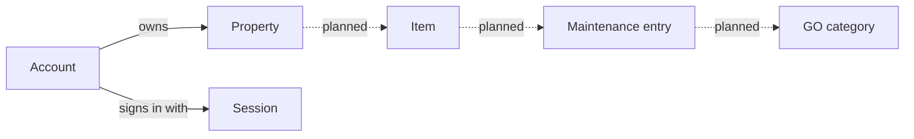

# Knowledge Base Index

Start here, every time, before you plan, build or review. Read this page in full, then every article that is relevant to your task. Maintained by agents with every change, per `.agents/skills/wiki/SKILL.md` ([how project knowledge is managed](process/project-knowledge.md)).

## Concept map

Verified against the code on 2026-11-19. The architecture and design articles do not exist yet; a backfill story writes them.

| Concept | Article | Code entry point | Related to |
|---------|---------|------------------|------------|
| Property | [GO Value Categories](product/go-categories.md) | GO Safer / Cheaper / Better and how the pilot uses them; open question on boiler service | 2026-11-19 |
| [Home Maintenance Log](product/home-maintenance-log.md) | `api/src/properties.ts`, `api/src/propertyRepository.ts`, `api/migrations/002_properties.sql`, `004_property_accounts.sql` | Account (owner) |
| Account | [GO Value Categories](product/go-categories.md) | GO Safer / Cheaper / Better and how the pilot uses them; open question on boiler service | 2026-11-19 |
| [Home Maintenance Log](product/home-maintenance-log.md) (section Accounts and sign-in) | `api/src/auth.ts`, `api/src/authRoutes.ts`, `api/src/googleClient.ts`, `api/migrations/003_users_sessions.sql` | Property, Session |
| Session | none yet | `api/src/auth.ts`, `api/src/authStores.ts`, `web/src/AuthGate.tsx` | Account |
| Item, Maintenance entry | [GO Value Categories](product/go-categories.md) | GO Safer / Cheaper / Better and how the pilot uses them; open question on boiler service | 2026-11-19 |
| [Home Maintenance Log](product/home-maintenance-log.md) (data model, planned) | none yet | Property, GO category |
| GO category | [GO Value Categories](product/go-categories.md) | none yet | Maintenance entry |

## product

What the app is, its scope and requirements.

| Article | Summary | Updated |
|---------|---------|---------|
| [GO Value Categories](product/go-categories.md) | GO Safer / Cheaper / Better and how the pilot uses them; open question on boiler service | 2026-11-19 |
| [Home Maintenance Log](product/home-maintenance-log.md) | Product scope v1: data model, property rules, Google sign-in, requirements, out of scope (SYNTHETIC) | 2026-11-19 |

## architecture

How the software is built: system, data model, API, auth, deploy. No articles yet.

## design

Design concepts, UI patterns, screens; assets in `design/assets/`. No articles yet.

## decisions

One record per product or technical decision. No records yet.

## users

Who uses the app and what they need.

| Article | Summary | Updated |
|---------|---------|---------|
| [Home Owner Persona](users/home-owner.md) | Mobile logging on site, yearly totals, Google sign-in decision, EUR only (SYNTHETIC) | 2026-11-19 |

## process

How work moves through the software factory.

| Article | Summary | Updated |
|---------|---------|---------|
| [Project Knowledge](process/project-knowledge.md) | How the wiki is structured, read and updated: index as single entry, concept map, topics, who writes what in every PR, CI check, reviewer duty, why | 2026-11-19 |
| [Story Workflow](process/story-workflow.md) | Stages, wiki update in every PR, human commands at the two gates, cancel, story split into sub-issues, human tasks, task comments and app secrets, follow-up stories, dependencies, quiet notifications, story owners, release, stalls and the watchdog | 2026-11-19 |
| [Factory Self-Hosting](process/factory-self-hosting.md) | Idea, not decided: the factory develops itself; why it fits, safeguards (lockout, rights, testing, watchdog), a software factory hub as the central entry point, publishing the learnings as a guide, suggested order | 2026-11-19 |

## lessons

What the project learned and why its rules exist.

| Article | Summary | Updated |
|---------|---------|---------|
| [Factory Spike Lessons](lessons/factory-spike-lessons.md) | Tweaks from running real stories through the factory: comment control, split, human tasks, secrets, follow-ups, dependencies, plan review, silent stalls, project knowledge, GitHub specifics | 2026-11-19 |
