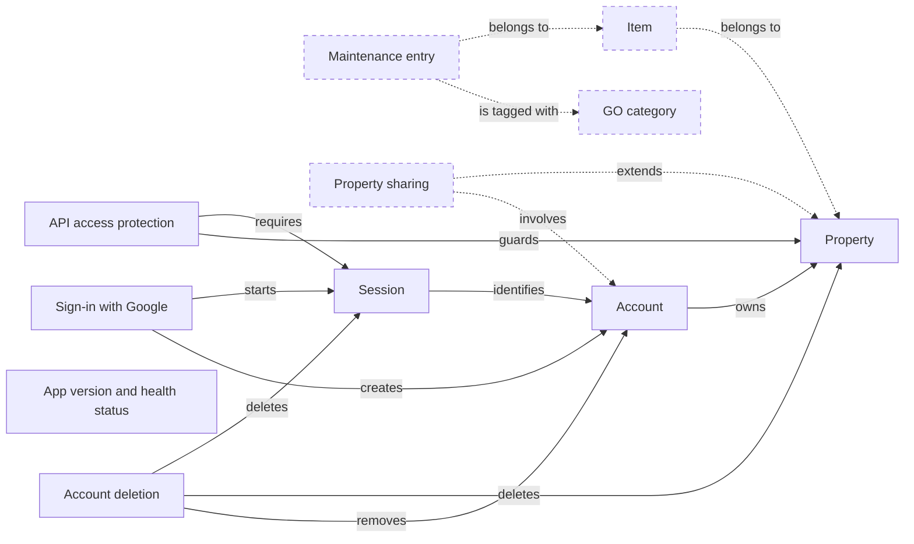

# Knowledge Base Index

<!-- Generated by .github/scripts/wiki-index.mjs from the front matter of each article. Do not edit by hand: run `npm run wiki:index`. On a merge conflict, take either side and regenerate. -->

Start here, every time, before you plan, build or review. Read this page in full, then every article that is relevant to your task. Maintained by agents with every change, per `.agents/skills/wiki/SKILL.md` ([how project knowledge is managed](process/project-knowledge.md)).

## Concept map

Solid boxes exist in the code; dashed boxes are planned and have no code yet.

| Concept | Article | Code entry point | Related to |
|---------|---------|------------------|------------|
| Account | [Account](product/account.md) | `api/src/auth.ts`, `api/src/authStores.ts`, `api/migrations/003_users_sessions.sql`, `web/src/components/AccountView.tsx` | Account deletion, Property, Property sharing, Session, Sign-in with Google |
| Account deletion | [Account deletion](product/account-deletion.md) | `api/src/authRoutes.ts`, `api/src/authStores.ts`, `web/src/components/DeleteAccountDialog.tsx` | Account, Property, Session |
| API access protection | [Authentication: Google sign-in, sessions and API access protection](architecture/authentication.md) | `api/src/authRoutes.ts`, `api/src/app.ts` | Property, Session |
| App version and health status | [App version and health status](product/app-version.md) | `api/src/app.ts`, `api/src/server.ts`, `web/src/api.ts`, `web/src/App.tsx` | none |
| GO category (planned) | [GO Value Categories](product/go-categories.md) | none (planned) | Maintenance entry |
| Item (planned) | [Home Maintenance Log](product/home-maintenance-log.md) | none (planned) | Maintenance entry, Property |
| Maintenance entry (planned) | [Home Maintenance Log](product/home-maintenance-log.md) | none (planned) | GO category, Item |
| Property | [Property](product/property.md) | `api/src/properties.ts`, `api/src/propertyRepository.ts`, `api/migrations/002_properties.sql`, `api/migrations/004_property_accounts.sql`, `web/src/components/PropertyForm.tsx` | Account, Account deletion, API access protection, Item, Property sharing |
| Property sharing (planned) | [Property](product/property.md) | none (planned) | Account, Property |
| Session | [Authentication: Google sign-in, sessions and API access protection](architecture/authentication.md) | `api/src/auth.ts`, `api/src/authStores.ts`, `api/src/authRoutes.ts`, `web/src/AuthGate.tsx` | Account, Account deletion, API access protection, Sign-in with Google |
| Sign-in with Google | [Authentication: Google sign-in, sessions and API access protection](architecture/authentication.md) | `api/src/authRoutes.ts`, `api/src/googleClient.ts`, `api/src/auth.ts`, `web/src/components/LoginScreen.tsx` | Account, Session |

## Articles by topic

## product

Product concepts and features: purpose, rules, status, relations.

| Article | Summary |
|---------|---------|
| [Account](product/account.md) | Account concept: created on first Google sign-in, matched on Google user id, stored fields, email and name stored as exception to synthetic data |
| [Account deletion](product/account-deletion.md) | Account view, danger zone, typed DELETE, what is deleted in one transaction, no grace period, logging |
| [App version and health status](product/app-version.md) | `/api/version`, footer text, `/api/health` answers, API status badge, use in the deploy smoke check |
| [GO Value Categories](product/go-categories.md) | GO Safer / Cheaper / Better and how the pilot uses them; open question on boiler service |
| [Home Maintenance Log](product/home-maintenance-log.md) | Product overview and scope v1: data model (Property exists; Item and Maintenance entry planned), requirements, out of scope, links to the concept articles (SYNTHETIC) |
| [Property](product/property.md) | Property concept: identity is address plus owner, required and optional fields, validation limits, one account per property, 404 for other accounts, hard delete, selection per browser, unowned properties never claimed |

## architecture

How the software is built: system, data model, API, auth, deploy.

| Article | Summary |
|---------|---------|
| [API](architecture/api.md) | Routes with method, public or protected, status codes, error bodies, dependency injection, logging |
| [Authentication: Google sign-in, sessions and API access protection](architecture/authentication.md) | Concepts Sign-in with Google (code flow, PKCE, state, nonce), test sign-in, fail-closed start-up, Session (hashed cookie token, 30 days sliding), API access protection |
| [Data model](architecture/data-model.md) | Tables app_info, properties, users, sessions, schema_migrations: keys, constraints, unique indexes, cascading and non-cascading foreign keys, migrations 001 to 004, the migration runner, stale comment in 004 |
| [System overview](architecture/system-overview.md) | Web (React, nginx), API (Hono), PostgreSQL 17, compose services and environment variables by name, local stack, CI, deploy script, preview and production environments, Caddy edge proxy |

## design

Design concepts, UI patterns, screens; assets in `design/assets/`.

| Article | Summary |
|---------|---------|
| [Screens](design/screens.md) | Login, empty state, switcher, details, add and edit form, delete dialogs, Account view, header and footer; behaviour at 390 px as far as the code shows it |
| [UI patterns](design/ui-patterns.md) | Button classes, form fields, inline errors, native modal dialogs, status and alert regions, danger zone, layout widths |

## decisions

One record per product or technical decision, named after the decision.

| Article | Summary |
|---------|---------|
| [A hand-written SQL migration runner with forward-only files](decisions/hand-written-migration-runner.md) | Hand-written forward-only migration runner, reason unknown (Data model) |
| [A property belongs to exactly one account, other accounts get 404](decisions/property-belongs-to-one-account-others-get-404.md) | A property belongs to one account, other accounts get 404 (Property, API access protection) |
| [A property is identified by its normalised address plus owner name](decisions/property-identity-address-and-owner.md) | Property identity is normalised address plus owner name (Property) |
| [Account deletion is permanent, confirmed by typing DELETE, in one transaction](decisions/account-deletion-is-permanent-with-typed-delete.md) | Account deletion is permanent, typed DELETE, one transaction (Account deletion) |
| [Accounts are matched on the Google user id, not on the email](decisions/accounts-matched-on-google-user-id.md) | Accounts are matched on the Google user id, not the email (Account) |
| [Countries are Netherlands and Germany, Netherlands is the default](decisions/countries-nl-and-de.md) | Countries NL and DE, NL default (Property) |
| [Editing a property is part of the first version](decisions/property-editing-is-included.md) | Editing is part of the first version, at the product owner's request (Property) |
| [Google is the only sign-in method and any Google account can sign up](decisions/google-only-sign-in-with-open-sign-up.md) | Google is the only sign-in, open sign-up, scopes openid email profile (Account) |
| [Labelled test sign-in on non-production stacks, fail closed in production](decisions/labelled-test-sign-in-fail-closed-in-production.md) | Labelled test sign-in on non-production stacks, fail closed in production (Sign-in with Google) |
| [Properties are deleted permanently after confirmation](decisions/properties-are-hard-deleted.md) | Properties are deleted permanently after confirmation (Property) |
| [Properties without an owner are never claimed automatically](decisions/unowned-properties-never-claimed-automatically.md) | Unowned properties are never claimed automatically, replaces the claim by the first account (Property) |
| [properties.account_user_id has no cascade on delete, sessions.user_id has one](decisions/property-foreign-key-without-cascade.md) | Property foreign key has no cascade, session foreign key has (Account deletion) |
| [Server-side sessions last 30 days from last use, with hashed tokens](decisions/server-side-sessions-30-days-hashed-tokens.md) | Server-side sessions, 30 days sliding, hashed tokens (Session) |
| [The API is a Hono app with injected dependencies](decisions/hono-app-with-injected-dependencies.md) | Hono app with injected dependencies, reason for Hono unknown (API) |
| [The app version is the version in api/package.json, shown in the footer](decisions/app-version-from-api-package-json.md) | App version is the version in api/package.json (App version and health status) |
| [The duplicate check applies per account](decisions/duplicate-check-per-account.md) | Duplicate check per account (Property) |
| [The first account that signs in claims properties without an owner](decisions/first-account-claims-unowned-properties.md) | Superseded: first account claims unowned properties (Property) |
| [The Google email and display name are stored, an exception to synthetic data](decisions/store-google-email-and-name.md) | Google email and name are stored, an exception to synthetic data (Account) |
| [The selected property is remembered per browser and cleared on sign-out](decisions/selected-property-remembered-per-browser.md) | Selected property is remembered per browser and cleared on sign-out (Property) |

## users

Who uses the app and what they need.

| Article | Summary |
|---------|---------|
| [Home Owner Persona](users/home-owner.md) | Mobile logging on site, yearly totals, Google sign-in decision, EUR only (SYNTHETIC) |

## process

How work moves through the software factory.

| Article | Summary |
|---------|---------|
| [Factory Self-Hosting](process/factory-self-hosting.md) | Idea, not decided: the factory develops itself; why it fits, safeguards (lockout, rights, testing, watchdog), a software factory hub as the central entry point, publishing the learnings as a guide, suggested order |
| [Project Knowledge](process/project-knowledge.md) | How the wiki is structured, read and updated: index generated from article front matter, concept map, topics, who writes what in every PR, CI checks, reviewer duty, rules for parallel PRs (no running numbers, generated lists, regenerate on conflict), why |
| [Story Workflow](process/story-workflow.md) | Stages, wiki update and tests per criterion in every PR, human commands at the two gates, cancel, story split into sub-issues, human tasks, task comments and app secrets, follow-up stories, dependencies, quiet notifications, story owners, release, stalls and the watchdog |
| [Testing](process/testing.md) | Tests as the regression suite: one test per acceptance criterion with its ID in the title, lowest test level, no extra tests, "Not automated" escape, CI criteria check, reviewer scope rules, why |

## lessons

What the project learned and why its rules exist.

| Article | Summary |
|---------|---------|
| [Factory Spike Lessons](lessons/factory-spike-lessons.md) | Tweaks from running real stories through the factory: comment control, split, human tasks, secrets, follow-ups, dependencies, plan review, silent stalls, project knowledge, tests, GitHub specifics |
